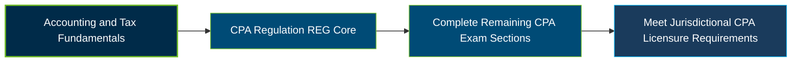

# AICPA CPA Regulation (REG) Exam Guide

A dedicated, comprehensive study guide and taxation reference repository for candidates preparing for the **AICPA Uniform CPA Examination – Taxation and Regulation (REG) section**.

---

## Exam Overview

The Taxation and Regulation (REG) section evaluates the knowledge and skills CPAs need in U.S. business law, professional responsibilities, and federal tax compliance for individuals and entities.

- **Exam Format**: Computer-based examination consisting of multiple-choice questions (MCQs) and task-based simulations (TBSs).
- **Target Audience**: CPA candidates, accounting graduates, tax associates, tax preparers, auditors, and accounting professionals.
- **Prerequisites**: Eligibility requirements vary by jurisdiction. Candidates should verify education and application requirements with their applicable Board of Accountancy.

---

## Core Exam Domains & Knowledge Areas

### 1. Ethics, Professional Responsibilities and Federal Tax Procedures

- Ethics and responsibilities in tax practice, including Treasury Department Circular 230.
- CPA licensing, disciplinary systems, and professional legal responsibilities.
- Federal tax procedures, audits, appeals, disclosures, substantiation, and penalties.

### 2. Business Law

- Business structures, entity formation, operation, and termination.
- Contracts, agency relationships, and debtor-creditor relationships.
- Government regulation of business, employment taxes, and applicable federal laws.

### 3. Federal Taxation of Property Transactions

- Tax basis of business and personal-use assets.
- Depreciation, amortization, and cost recovery.
- Federal tax treatment of property acquisitions and dispositions.

### 4. Federal Taxation of Individuals

- Gross income, exclusions, adjusted gross income, and taxable income.
- Individual deductions, credits, filing statuses, and estimated tax requirements.
- Pass-through income, loss limitations, and individual tax return preparation.

### 5. Federal Taxation of Entities (including tax preparation)

- Taxable income calculations and book-to-tax adjustments for entities.
- Federal taxation of C corporations, S corporations, and partnerships.
- Entity basis, separately stated items, tax elections, and tax-exempt organizations.

---

## Certification Path

The following diagram represents a suggested examination and licensure progression. REG is one of the three required Core sections of the Uniform CPA Examination.

---

## Recommended Practice & Study Resources

To prepare effectively for the CPA REG section, combine the official examination blueprint with federal tax research and practical application of business law concepts.

- **CertsGate**: Explore [AICPA CPA Regulation (REG) preparation resources](https://certsgate.com/exams/aicpa/cpa-regulation) for supplementary study materials and practice questions.
- **IRS & Federal Tax Resources**: Use the [Internal Revenue Service](https://www.irs.gov/) website, Internal Revenue Code resources, Treasury regulations, and official tax forms and instructions to strengthen federal tax knowledge.
